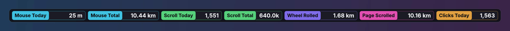
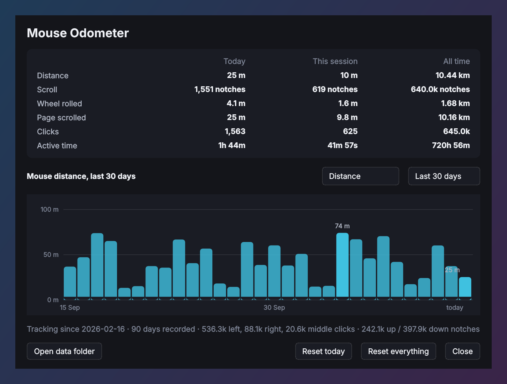

# Mouse Odometer

   

A small always-on-top bar that counts how far your mouse has travelled, how much
you have scrolled, and how much you have clicked — and keeps counting across
reboots. Double-click the bar for history and a daily chart.



<p align="center"></p>

## Requirements

* Windows 10 or 11
* Python 3.10 or newer on `PATH` ([python.org](https://www.python.org/downloads/))
* [PySide6](https://pypi.org/project/PySide6/) and [pynput](https://pypi.org/project/pynput/) — installed automatically by `run.bat`

## Running it

```
git clone https://github.com/viruztt/MouseOdometer.git
cd MouseOdometer
run.bat
```

Or download the ZIP from GitHub, extract it, and double-click **`run.bat`**.
The first run creates a `.venv` beside the script, installs the dependencies,
then launches with `pythonw` (no console window).

Then run **`install_startup.bat`** once so it starts with Windows and the totals
keep accumulating. It puts a shortcut in your Startup folder pointing straight at
`.venv\Scripts\pythonw.exe main.py`, so there is no console window at sign-in.
**`remove_startup.bat`** undoes it. If you move or rename the folder, run
`install_startup.bat` again so the shortcut picks up the new path.

* **`report.bat`** prints the current figures to a console and exits.
* **`selftest.bat`** verifies that counters persist and reports which tracking
  backend is available.

## Using it

* **Drag** the bar anywhere; the position is remembered.
* **Double-click** it — or use the tray icon — to open the stats window.
* **Right-click** for the menu: which chips to show, mouse DPI, sparklines,
  opacity, text size, window layer, click-through.
* **Window layer** sets how the bar stacks: *Always on top*, *Normal* (other
  windows can cover it), or *Always at the bottom* (it sits on the wallpaper).
  The bar has no taskbar button, so if you lose it use **Bring bar to front** on
  the tray icon.
* **Hover** a chip for detail (pixels, up/down notches, per-button clicks).

The stats window shows today / this session / all time for every counter, plus a
daily bar chart you can switch between distance, scroll notches, wheel rolled,
page scrolled and clicks over the last 7, 30 or 90 days. Hover a bar for that
day's figure. Reset buttons are there too — both ask first.

## What gets counted

| Counter | Meaning |
|---|---|
| Distance | Cursor travel, summed between mouse events and converted to real desk distance |
| Scroll | Wheel notches, up and down separately (horizontal tilt counts too) |
| Wheel rolled | Those notches as physical rim travel — how far the wheel turned under your finger |
| Page scrolled | Those notches as document length — how much page flowed past, as if it were paper |
| Clicks | Left, right and middle, counted on press |
| Active time | Wall-clock seconds in which at least one mouse event happened |

Only mouse events are hooked. **No keyboard hook is installed**, so nothing here
can see what you type — worth knowing, since that is the usual reason this class
of app makes people nervous.

### How distance is calculated

The hook reports cursor positions in screen pixels. Real desk distance is
`pixels ÷ mouse DPI`, so the **DPI setting has to match your mouse** or the
number is scaled wrong — set it from the right-click menu (default 800).

Two caveats worth stating plainly:

* **Windows pointer acceleration** ("Enhance pointer precision") and the pointer
  speed slider break the pixel↔desk relationship: the same physical movement
  covers different pixel counts depending on how fast you move. If the slider is
  not at the default 6/11, set `pointer_scale` in `config.json` to roughly the
  ratio (e.g. `1.5` if the cursor moves half again as far as it should). The
  figure is an estimate either way.
* **Cursor warps are ignored.** Any single jump longer than `teleport_px`
  (4000 px) is treated as a game recentring the pointer or a remote-desktop jump
  rather than a hand movement, so it isn't counted.

Scroll notches are exact. Clicks are exact.

### The two scroll distances

Notches are the honest measurement; both metre figures are derived from the same
count, and they differ by roughly 6×, so it is worth knowing which is which.

**Wheel rolled** treats the wheel as a rolling wheel: one notch turns the rim by
`π × diameter ÷ detents`. At the default 20 mm wheel with 24 detents that is
**2.6 mm per notch** — about 2.6 m per thousand notches. Measure your wheel and
set `wheel_diameter_mm` / `wheel_detents` if you want it exact.

**Page scrolled** treats the document as paper: `notches × 3 lines × 20 px ÷ 96
DPI`, about **1.6 cm per notch** — roughly 16 m per thousand notches. This is the
softer of the two, because apps override lines-per-notch constantly: a browser at
125 % zoom, an editor, a PDF viewer and anything with smooth scrolling all move a
different amount per notch. Treat it as an order-of-magnitude figure. Set
`screen_dpi`, `lines_per_notch` and `px_per_line` to match your setup.

Both are shown in the stats window and available as chips; hover a chip to see
the per-notch figure it is using.

## Where the data lives

`data/odometer.json` next to the app — plain JSON, easy to read or back up:

```json
{"version":1,"created":"2026-09-12T14:02:11",
 "totals":{"px":91234567.0,"su":59100,"sd":182600,"l":246100,"r":40400,"m":9482,"sec":1191000},
 "days":{"2026-09-12":{"px":1904233.0,"su":1400,"sd":2300,"l":3100,"r":510,"m":120,"sec":15000}}}
```

`px` is raw pixels, `su`/`sd` scroll up/down notches, `l`/`r`/`m` clicks by
button, `sec` active seconds. Daily rows are kept for three years.

It is written every 30 seconds and on exit, via a temp file and an atomic
rename, with one rolling `.bak` — so a crash or power cut costs at most the last
half-minute, never the whole history. If the main file is ever unreadable the
backup is loaded instead. (That also means deleting the file by hand doesn't
clear your totals — use **Reset everything**, which removes both.)

Set `data_path` in `config.json` to keep the data elsewhere, for example in
OneDrive so it follows you between machines.

## Configuration

`config.json` is written next to `main.py` and updated whenever you change
something from the menu.

| Key | Meaning |
|---|---|
| `mouse_dpi` | Sensor DPI of your mouse — distance depends on it |
| `pointer_scale` | Correction for a non-default Windows pointer speed |
| `wheel_diameter_mm`, `wheel_detents` | Your wheel's size and clicks per turn — drives **Wheel rolled** |
| `screen_dpi`, `lines_per_notch`, `px_per_line` | Drive **Page scrolled** |
| `chips` | Which counters the bar shows, in order |
| `refresh` | Seconds between display updates |
| `autosave` | Seconds between writes to disk |
| `teleport_px` | Single-event jumps longer than this are ignored |
| `data_path` | Where to store the counters (blank = `data/odometer.json`) |
| `schema` | Internal — bumped when new chips are added, so an existing config picks them up |
| `window_layer` | `top`, `normal`, or `bottom` |
| `opacity`, `font_size`, `click_through`, `show_sparklines` | Appearance |

## Only one at a time

The app refuses to start twice against the same data file — a second launch just
re-shows the bar that is already running. Two instances would each install a hook
and both write the same file, so the counts would clobber each other.

If you want a second bar for a different purpose, point it at a different
`data_path` and it will run alongside.

## Tracking backends

1. **pynput** — a low-level Windows mouse hook. Sees movement, wheel and clicks
   in every application. This is the normal path.
2. **Cursor polling** — `GetCursorPos` at 60 Hz, used only if the hook cannot be
   installed. Distance still works; wheel and clicks do not.

`selftest.bat` reports which one is in use. One thing to expect: because it
installs a global hook, some antivirus and anti-cheat software takes an interest.
It cannot read keystrokes, but a competitive game with kernel anti-cheat may
still object to any injected hook — quit the bar before playing if that comes up.

## Layout

```
main.py               entry point (--report, --selftest)
run.bat               first-run installer + launcher
install_startup.bat   add/remove the Windows startup shortcut
remove_startup.bat
report.bat            print current figures
selftest.bat          persistence + backend check
tools/
  make_screenshot.py   renders docs/*.png from made-up counts
odometer/
  config.py           JSON settings
  store.py            counters, per-day history, atomic save
  tracker.py          pynput hook / cursor-polling fallback
  units.py            pixels -> metres, formatting
  chips.py            the chip widget
  widget.py           the floating bar
  statswindow.py      stats and the daily chart
```

Your counters (`data/`) and settings (`config.json`) are git-ignored, so they
never end up in the repository.

## License

[MIT](LICENSE)
